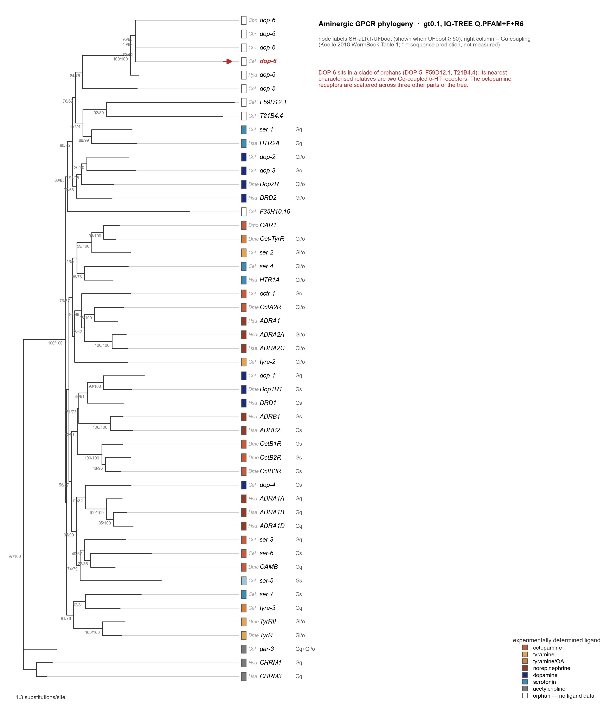

# dop-6 / C24A8.6 — an inverted duplication, and whether DOP-6 is an octopamine receptor

Sub-project started 2026-09-16. Motivation: strains CHS1223 and CHS1256 (Pu et al. 2023,
*Nat Commun* 14:8410, PMID 38110404, Chen lab) both show an octopamine-related phenotype, and the
only genes they share are **dop-6** and **C24A8.6**.

---

## 1. The locus is a perfect inverted repeat, and C24A8.6 is half of dop-6

| | coordinates (WBcel235, chromosome X) | |
|---|---|---|
| arm A | 4,324,178–4,328,106 | 3,929 bp — dop-6 exons 10–17 |
| spacer | 4,328,107–4,329,302 | 1,196 bp — contains C24A8.5 |
| arm B | 4,329,303–4,333,231 | 3,929 bp — **reverse complement of arm A**; contains all of C24A8.6 |

**Identity 3,929/3,929 = 100.000 %, zero mismatches, sharp junctions.** The spacer is not itself
palindromic (26 % self-complementarity = background).

* **dop-6 = C24A8.1**, X:4,320,863–4,327,331 (+), 692 aa, 17 exons. Exons 1–9 (3,315 bp, codons
  1–405) are single-copy; exons 10–17 lie entirely in arm A.
* **C24A8.6** lies entirely in arm B: **0 bp of its 2,330 bp is unique**.
* **C24A8.6a (287 aa) is DOP-6 residues 406–692, exactly — 287/287 identical.** C24A8.6b adds a
  17 aa cryptic exon spliced from what is dop-6 intron 14. C24A8.6a's start codon *is* DOP-6's
  internal Met406, which makes the gene model look like an ORF-finder artefact on the inverted copy.
* That segment is end-of-ICL3 + TM6 + ECL3 + TM7 + the whole C-tail. The ligand pocket is **not**
  in it: the TM3 aspartate and the `DRL` motif (D120-R121-L122) are at ~residue 120, in the unique
  half. So C24A8.6 can encode at most a two-TM fragment with no binding pocket.
* The two mRNAs carry the **identical** 864 nt sequence (not reverse complements — verified), so no
  dsRNA/endo-siRNA mechanism is available, and reads from either are the same string.

**Consequences.** C24A8.6 cannot be measured apart from dop-6 by any short-read method, cannot be
mutated without also cutting dop-6, and has no diagnostic base anywhere. dop-6 *is* fully tractable
through exons 1–9. See `output/repeat_structure.txt`, `output/specific_tools.txt`,
`output/dop6_guides.tsv`.

## 2. It is real, and it is a common natural polymorphism

`survey_assemblies.py` over **56 assemblies** (`output/assembly_survey.tsv`):

| | 1 copy | 2 copies |
|---|---|---|
| N2 reference | | 1 |
| N2-derived lab strains | 0 | 7 (N2×3 pipelines, CGC1, UA44, BY250, yA, yA1244) |
| natural isolates | **19** | **29** |

Not an assembly artefact: present in three independent N2 assemblies (Sanger cosmid, U. Oregon
long-read, Wellcome Sanger). Not an assembler collapse in the non-carriers either — the U. Oregon
N2 and CB4856 assemblies are the same BioProject, same pipeline, same release date, and differ.
Replicates agree across pipelines: CB4856 1 copy in 3 assemblies, DL238 and ECA36 1 copy in 2 each,
EG4725 2 copies in 2. Absent from *C. briggsae*, *C. brenneri*, *C. remanei*, *C. japonica*.

**Arm-vs-arm identity is 100.000 % in the reference and 99.87–99.98 % in long-read carriers** — the
residual is most likely long-read basecalling error, not divergence.

### It sits on a ~2 Mb haplotype shared with N2 — not contamination, but not independent either

`haplotype_context.py` + `haplotype_extent.py`. Mean % identity to N2 in single-copy windows:

| window | carriers (n=29) | non-carriers (n=19) |
|---|---|---|
| dop-6 flank, left (X) | **99.977** | **99.477** |
| dop-6 flank, right (X) | **99.974** | **99.626** |
| X, 5.7 Mb away | 99.702 | 99.686 |
| chromosome II | 99.802 | 99.728 |
| chromosome III | 99.951 | 99.847 |

**Not whole-genome N2 contamination**: carriers show ordinary wild divergence from N2 on II and III.
**But carriage is identity-by-descent, not independent**: scanning outward along the X, the
carrier-specific N2-like block runs from about **−1 Mb to +1 Mb**, has decayed by ±3 Mb and is gone
by ±6 Mb. So the 29 carriers are essentially *one* haplotype observed 29 times, and whether the
duplication itself is under selection or merely hitchhiking on a swept chromosome-X haplotype
cannot be separated with these data. *C. elegans* selfs, so blocks persist far longer than in an
outcrosser and the block length must not be converted into a date.

## 3. Everything short-read at this locus is blind

CaeNDR 20250625, 684 isotypes, variant density per kb: unique flank **24.75**, spacer **34.28**,
arm A **3.82**, arm B **0.25**. The arms are a mapping-ambiguity desert (MAPQ 0), not a conserved
region. Therefore:

* Any πN/πS or polymorphism-based constraint estimate for codons 406–692 from short reads is
  meaningless — it will read as spuriously ultra-conserved.
* **Pu et al. validated their alleles by BWA-MEM against WS235 plus Pindel**, which cannot resolve
  these arms; they explicitly have a "disrupted larger CNV" class covering *"duplications,
  inversions, large deletions, or the combination of these events"*. The `c24a8.6` guide necessarily
  had two perfect targets 9 kb apart in inverted orientation. **Get Supplementary Data 1d (guides)
  and 1f (per-allele calls) and check `yum2349`, `yum2350`, `yum2603`, `yum2604` before treating
  dop-6 and c24a8.6 as independent lesions.**
* The fix is the one the assemblies already implement: read each isolate in its own coordinates.
  `polymorphism_from_assemblies.py` rebuilds the dop-6 CDS exon-by-exon from 56 assemblies and
  recovers what mapping cannot (`output/dop6_polymorphism.tsv`):

  | | segregating sites, N-half exons | segregating sites, C-half exons |
  |---|---|---|
  | CaeNDR short reads, 684 isotypes | 10 | **0** |
  | assemblies, 56 isolates | 3 | **7** |

  Short-read mapping reports **zero** variation across the whole duplicated half; the assemblies
  find seven segregating sites there from a sample an order of magnitude smaller. Biologically the
  result is also striking: **piN = 0 in both halves — all 10 segregating sites are synonymous**,
  across 56 natural isolates. Carriers are nearly invariant (1 site) versus non-carriers (8),
  which is the same shared-haplotype signal as above, not extra constraint.

## 3b. The strains: one guide, two cut sites, and a 75 kb duplication

Resolved 2026-09-16 from Pu et al. Supplementary Data 1 (`41467_2023_44177_MOESM4_ESM.xlsx`,
sheets d, e, f), supplied by MOD. This is the most consequential result in the sub-project.

**dop-6 and C24A8.6 were never targeted independently.** Sheet d gives *the same* guide, PAM and
ssODN for both:

```
guide  CAAGTTGGTTGCAACTGTAA   PAM TGG   ssODN ...CCAAGTTGGTT TAA AAGCTT TAA actgaaact...
```

Only the genotyping primers differ, because those sit in the unique flanks either side. That guide
has **exactly two perfect full-length matches in WBcel235** — X:4,325,604-4,325,623 (arm A, in
dop-6) and X:4,331,786-4,331,805 (arm B, in C24A8.6, minus strand) — as it must, since the arms are
identical. So one cutting reagent made two double-strand breaks 6.2 kb apart in inverted
orientation, and `yum2349`/`yum2350` (and `yum2603`/`yum2604`) are the two ends of one event, not
two alleles.

**CHS1223 is a complex rearrangement, not a double null.** Sheet f, both alleles, class
*"disrupted larger CNV"*:

| allele | gene | detected variation | location |
|---|---|---|---|
| yum2349 | dop-6 | **Inversion with insertion** (50 bp) | X:4,325,629-4,330,411 |
| yum2350 | C24A8.6 | — | — |

with the shared comment: ***"4kb deletion into dop-6 and C24A8.5, plus 75kb TD spanning multiple
genes"***. So the strain carries a 4 kb deletion taking out part of dop-6 *and* C24A8.5, an
inversion with a 50 bp insertion, and a **75 kb tandem duplication over an unspecified set of
genes**. The strain's other three alleles (F38E1.6, F09C6.16, K01A6.6, on V/V/IV) are clean.

**CHS1256's dop-6 and C24A8.6 alleles were never actually detected.** Sheet f records both as
*"not detected by Pindel"*, *"manually curated via IGV"*, with no mutation location and no detected
variation — in precisely the interval where short reads map at MAPQ 0 (§3). Two of that strain's
other alleles are also CNV-class (`ser-6`: "large deletion, part of ser-6 (2xINV)"; `dop-4`:
"2xINV, deletion of dop-4 exon 1"). It also carries `dop-1(yum2598)` at X:4,415,971, ~90 kb from
the dop-6 cut sites — three breaks inside 90 kb of chromosome X in one injection.

For scale, *"disrupted larger CNV"* is 82 of 1,725 alleles (4.8 %) across the whole resource;
CHS1223 has one and CHS1256 has three.

**Consequence for the project.** The shared-gene argument — "the only genes CHS1223 and CHS1256
have in common are dop-6 and C24A8.6" — does not survive this. The two are one target, so they
cannot be separated genetically in these strains; CHS1223 additionally carries a 75 kb duplication
over multiple genes and a deletion of C24A8.5; and CHS1256's dop-6/C24A8.6 lesions rest on manual
inspection of unmappable reads. **An octopamine phenotype in these strains cannot presently be
attributed to dop-6.** Pu et al. document all of this honestly in their supplement; the CGC genotype
strings do not.

This makes the clean experiment in §"Next" not merely preferable but necessary: a fresh dop-6 null
cut in the unique 5' half (a single-target guide, `output/dop6_guides.tsv`), outcrossed, plus cDNA
rescue.

## 4. DOP-6 is not a dopamine receptor — it is an orphan, and a strongly constrained one

* No pharmacology of any kind. Named by homology in Chase & Koelle 2004. **Koelle 2018 WormBook
  (NBK535514) Table 1 lists it as `C24A8.1` under "Poorly-studied putative small-molecule GPCRs",
  with every ligand, coupling and assay column empty** — and lists `C24A8.6` separately, propagating
  the reference artefact. The full orphan set is T02E9.3 (= dop-5), C24A8.1 (= dop-6), C24A8.6,
  F35H10.10, F59D12.1, T21B4.4.
* dN/dS vs *C. briggsae* (`output/dnds_vs_briggsae.tsv`): dop-6 **dN = 0.0252**, the lowest of the
  aminergic receptors tested (dop-5 0.0261, ser-2 0.0290, dop-1 0.0322, ser-3 0.0500, dop-2 0.0508,
  ser-4 0.0609, dop-3 0.0618, dop-4 0.0733). dS is saturated throughout, so dN is the usable column.
* The palindrome does **not** bias that estimate (`output/mirror_bias_check.txt`): N2-vs-wild
  divergence is equal or higher in the C-half; recomputing dN from four palindrome-free isolates'
  own CDSs gives identical values; and the N-half/C-half dN difference is not significant anyway
  (Fisher p = 0.258). The duplication also postdates the *C. briggsae* split by a vast margin.

## 5. Could the duplicated C-terminus bind a G protein on its own?

Interface defined from coordinates (≤4.5 Å) in **11 receptor–G protein complexes spanning Gs, Gi,
Go, Gq and G11**, with receptor and Gα chains identified by sequence, not by chain label
(`output/gprotein_interface_multi.tsv`). Consensus contacts (≥6 of 11) = 20 positions: **13 lost,
7 retained → the fragment keeps ~35 %**. Per class 29–41 %; no class rescues it.

What is lost is decisive: **R121, the DRY arginine, is a Gα contact in 11 of 11 structures**, plus
the whole ICL2 patch (A124, A125, P128, A129, Y131, K132, T133) and TM5/ICL3 (I206, L210, R213).
Retained: R467, R470, A471, L474, V475 (TM6 cytoplasmic end) and I534, N535. The Gα α5 helix docks
into a cavity opened by TM6 swinging away from TM3; with no TM3 there is no cavity. The live
hypothesis is therefore **not** autonomous signalling but complementation with / competition against
full-length DOP-6, or GRK/arrestin sequestration via the serine-rich tail.

## 6. Tree — DOP-6 is not in an octopamine clade

50 sequences: all *C. elegans* aminergic receptors + Koelle's orphan set + human adrenergic /
dopamine / serotonin / muscarinic + Drosophila OA/TA/DA + *Bombyx* + *Platynereis* + dop-6
orthologs. MAFFT L-INS-i → trimAl ×4 → IQ-TREE ModelFinder + 1000 UFBoot + 1000 SH-aLRT, rooted on
muscarinic. All 20 Gα-contact columns survive every trim level.

**Tips are labelled by pharmacology, not gene name** — this matters: SER-2 is a *tyramine* receptor,
SER-3 and SER-6 are *octopamine* receptors, dop-5/dop-6 are orphans.

Best-fit model Q.PFAM+F+R6 (gt0.1, 1,034 columns, 50 taxa).



*`plot_tree.py` — also rendered for gappyout, gt0.2 and gt0.3.*

**Can the tree predict anything?** Tested rather than assumed. The precedent for inferring a
receptor's G protein from its nearest characterised relative is SER-5's Gs call (Harris et al. 2009,
*J Neurosci* 29:1446, PMID 19193891), and having now read that paper, its validation is weaker than
the citation implies:

* the tree was **5-HT receptors only**, rooted on GAR-1 — it could not have contained dop-6, and
  coupling clustering was judged inside a single ligand class, where coupling and receptor subtype
  covary strongly;
* the method was ClustalW in MegAlign/DNAStar, **hand-tuned**, then neighbour-joining distance in
  PAUP 4.0b10 with DNAStar bootstrapping — no ML, no model selection;
* **hypervariable regions were deleted**, including the third intracellular loop — which is where
  part of the Gα interface actually lives (see §5: ICL2 and TM5/ICL3 contacts dominate in all 11
  complexes), so coupling clustering was assessed on an alignment stripped of some of its own
  determinants;
* the validation itself is the sentence *"all of the previously characterized 5-HT receptors
  clustered according to their documented G-protein coupling, regardless of phylogenetic origin,
  validating the utility of the tree"* — an eyeball assessment, with no statistical test.

So the intuition deserves testing, not inheriting. Fitch parsimony vs 10,000 label permutations, on both final trees
(`output/tree/trait_signal.txt`):

| trait | tips with data | observed changes | random mean | p | trim levels |
|---|---|---|---|---|---|
| ligand | 36 | 12–13 | 22.5–22.6 | 0.0001 | all 4 |
| Gα coupling | 36 | 8 | 16.9–17.0 | 0.0001 | all 4 |

Both are significantly clustered at every trim level, so tree position is informative about both —
though 12 ligand changes across 36 tips means transmitter identity still switches a lot within the
family. This is the formal version of Harris 2009's qualitative claim, run across the whole
aminergic family rather than within one ligand class, and it supports their intuition.

**Where DOP-6 falls** (identical composition at all four trim levels; support ranges below):

```
100/100            dop-6 orthologs (Cel, Cbr, Cbn, Cre, Ppa)
83.5-89.6 / 64-76  + cel_dop-5
73.1-79.4 / 37-62  + cel_F59D12.1, cel_T21B4.4, cel_ser-1 [5HT|Gq], hHTR2A [5HT|Gq]
```

Two things follow. First, **four of Koelle's six orphans — dop-5 (T02E9.3), dop-6 (C24A8.1),
F59D12.1 and T21B4.4 — form a coherent group**, with SER-1/HTR2A nested inside it. They are a real
receptor lineage, not a grab-bag of leftovers. Second, and directly against the working hypothesis,
**DOP-6 does not group with any octopamine receptor.** The OA receptors sit in three separate
places — OCTR-1 with the α2-adrenergic/Gi-o block, SER-3/SER-6 with dmOAMB in the Gq/Gs block, and
dmOctβ1/2/3R with the β-adrenergic/Gs block — and DOP-6 is in none of them. Its nearest
characterised relatives are two **5-HT receptors, both Gq**.

Support for that placement is moderate and trim-sensitive (SH-aLRT 73–79, UFboot 37–62), and every one of DOP-6's closer neighbours is
itself an orphan, so the honest summary is: the tree places DOP-6 in an uncharacterised
nematode-enriched lineage adjacent to 5-HT2-like/Gq receptors, and gives no positive phylogenetic
support for it being an octopamine receptor. Prior to weigh against: Harris 2010 constrains the
sought receptor to Gαo signalling or Gαq inhibition — a Gq-adjacent placement is not inconsistent
with the latter, but that is a hypothesis, not a result.

## Scripts

| script | does |
|---|---|
| `fetch_locus.py` | locus sequence + gene models from Ensembl |
| `analyze_duplication.py` | repeat boundaries, exon mapping, protein relationship |
| `crossspecies_palindrome.py` | other *Caenorhabditis* loci |
| `ortholog_divergence.py` | divergence per half, protein and nucleotide |
| `selection_dnds.py` | NG86 dN/dS vs *C. briggsae* for 17 receptors |
| `mirror_bias_check.py` | does the palindrome bias the dN estimate |
| `wild_isolates.py` | CaeNDR variant density across the locus |
| `assembly_copy_number.py`, `survey_assemblies.py` | copy number across 56 assemblies |
| `wild_locus_structure.py` | per-assembly locus structure, gene-anchored |
| `haplotype_context.py`, `haplotype_extent.py` | polymorphism vs contamination vs sweep; haplotype block length |
| `polymorphism_from_assemblies.py` | diversity without mapping to a duplicated reference |
| `design_specific_tools.py` | dop-6-specific guides, primers, junction PCRs |
| `gprotein_interface.py`, `gprotein_interface_multi.py` | Gα interface mapping |
| `fetch_tree_seqs.py`, `curate_tree_panel.py`, `build_tree.py` | panel, curation, alignment, trees |
| `trait_signal.py` | can the tree predict ligand / coupling (Fitch + permutation) |
| `render_tree.py`, `plot_tree.py` | text tree; publication figure |

## Next

1. **BLOCKED, needs a human:** Pu et al. Supplementary Data 1d and 1f (guides and per-allele CNV
   calls) — needed to know what `yum2349/2350/2603/2604` actually are. Also the Harris et al. 2009
   full text (jneurosci.org is Cloudflare-blocked here; PMC has abstract only).
3. **Deorphanising DOP-6 in a heterologous system may not work.** The Komuniecki lab reported in
   the same paper that direct characterisation of SER-5 was unsuccessful, that similar attempts on
   other *C. elegans* GPCRs had failed (Rex & Komuniecki 2002; Hobson et al. 2003), and that this
   "may be problematic in the absence of a nematode cell line" because heterologous expression of
   many *C. elegans* GPCRs is poor and may require accessory proteins. Budget for that, or plan an
   in-vivo readout (e.g. epistasis with *goa-1* / *egl-30* / *gsa-1*) instead.
4. Decisive experiment, independent of all of the above: **a dop-6 null made in the unique 5′ half
   (leaving both arms untouched) plus cDNA rescue.** That assigns the phenotype without ever having
   to separate the two copies. A C24A8.6-specific null is not cleanly possible — arm B's only
   unique flanks are the spacer and a point inside cst-2's last exon.

## 6b. How the tree alignment is built, and what is deliberately thrown away

**This is the single most consequential methodological choice in the sub-project and it is stated
here in full, because it determines what the tree can and cannot answer.**

### The problem

Aminergic GPCRs share a ~250-residue seven-transmembrane core but differ enormously outside it. In
this 164-taxon panel the third intracellular loop (ICL3) ranges from **14 to 821 residues**; DOP-6's
is ~240. Aligning full-length sequences forces DOP-6's 240-residue ICL3 into the same columns as
beta2AR's 34, which has no correct answer. The result was an alignment that was **84.4 % gaps with
all 164 sequences above 50 %** — unusable.

### What is actually done

`extract_domains.py`. Each sequence is scanned with the monoamine HMM. A 7TM receptor does **not**
align to the model as one block: the alignment breaks at the insertions, and hmmsearch reports the
receptor in pieces. For DOP-6:

```
block 1: residues  27-164   = model positions   2-122
block 2: residues 181-224   = model positions 119-162
block 3: residues 466-546   = model positions 152-224
                  ↑ 241 residues skipped between blocks 2 and 3 — this is ICL3
```

The model coordinates run continuously (2→224); only the *receptor* coordinates jump. Three options
exist and only one works:

| | DOP-6 | beta2AR | dmOctB3R | |
|---|---|---|---|---|
| best block only | 138 aa | 140 aa | 142 aa | loses TM6, TM7 |
| span, first→last | 520 aa | 303 aa | 1093 aa | ICL3 back inside |
| **blocks concatenated** | **263 aa** | **254 aa** | **258 aa** | ← used |

Sequences of 413, 692 and 1256 aa converge on 254–263 aa. A **15-residue margin** is added each side
of every block (an HMM envelope is a detection threshold, not a domain boundary) and overlapping
blocks are merged. This is the same operation Harris et al. 2009 performed by hand; the HMM finds
the boundaries automatically.

### Effect

| | full-length | 7TM excerpts |
|---|---|---|
| taxa × columns (gt0.1) | 49 × 1034 | 163 × 362 |
| total gaps | 48.5 % | **11.4 %** |
| parsimony-informative | 783 / 1034 (76 %) | **356 / 362 (98 %)** |
| composition chi2 failures | 15 | 8 |

### What is thrown away, and three checks that it is safe

**1. The Galpha interface survives intact** (`output/gprotein_survival.txt`). ICL3 contributes to G
protein binding, so excising it could have deleted the residues the coupling argument rests on. It
does not: **all 20 consensus Galpha-contact positions** (contacting in ≥6 of 11 receptor–G protein
complexes) fall inside retained blocks in DOP-6 — including the TM5/ICL3 positions I206, L210, R213
and the TM6 positions R467, R470, A471, L474, V475. The reason is structural: **ICL3 contacts Galpha
at its ends**, where it leaves TM5 and enters TM6, and those ends are the conserved helix boundaries
the HMM recognises. The excised region is the middle of the loop (DOP-6 240–450), which makes no
consensus contact. For compact receptors the excision is negligible — beta2AR loses 4 aa.

**2. The ligand pocket survives.** D3.32, located independently from three ligand-bound structures,
is present in the excerpt of every receptor known to carry it.

**3. ICL3's own signal was measured, not assumed** (`output/icl3_information.txt`). Two results,
pointing opposite ways:

* ICL3 **length is phylogenetically conserved** — mean |length difference| between sister tips is
  52.7 aa versus 110.8 aa when lengths are shuffled across tips, p = 0.0001. So the loop is not
  noise; it carries real lineage information.
* ICL3 **sequence stops being comparable with depth** — identity runs 76.8 % between orthologues
  (7TM core: 86.5 %), 28.4 % between *C. elegans* paralogues (core 31.9 %), 26.4 % *C. elegans* vs
  human (core 37.1 %). *Caveat: these are global pairwise identities counted only over positions
  where both sequences have residues, which inflates the figure when the two loops differ greatly
  in length — the alignable fraction, not the identity, is the real limit.*

**Honest conclusion:** ICL3 does carry lineage signal, and excising it does lose something — but the
signal is usable only within orthologue groups, far shallower than the nodes this tree exists to
resolve, and retaining it destroys the deep alignment outright. The right use of ICL3 is as a
separate shallow-depth marker, not as tree columns.

### The limit this leaves

356 parsimony-informative sites for 163 taxa is **~1.1 sites per free parameter** (an unrooted
163-taxon tree has 323 branches). Domain-only alignments are routinely under-determined, so this
ratio is reported alongside any formal topology test rather than left implicit, and deep nodes in
this tree should be expected to carry modest support.
